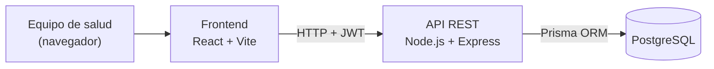

<div align="center">

# CESFAM Programa Infantil

**Sistema de gestión clínica para el Programa Infantil del CESFAM Santa Sabina**

Pacientes · Controles clínicos · Agenda · Talleres NANEAS · Reportes · Importación desde Excel

<br>


<br>


<br>

[Sobre el proyecto](#sobre-el-proyecto) ·
[Funcionalidades](#funcionalidades) ·
[Arquitectura](#arquitectura) ·
[Tecnologías](#tecnologías) ·
[Instalación](#instalación-y-ejecución-local) ·
[Usuarios](#gestión-de-usuarios) ·
[Despliegue](#despliegue-en-servidor) ·
[Licencia](#licencia)

</div>

---

## Sobre el proyecto

`cesfam-programa-infantil` es el sistema de gestión clínica desarrollado como **proyecto de título** para el Programa Infantil del CESFAM Santa Sabina. Digitaliza el seguimiento de los niños, niñas y adolescentes inscritos en el programa y reemplaza los registros manuales por una plataforma centralizada para el equipo de salud.

| Población atendida | Rango de edad |
|---|---|
| Programa Infantil | 0 a 10 años |
| NANEAS (TEA y otros diagnósticos) | hasta los 18 años |

---

## Funcionalidades

| Módulo | Qué permite |
|---|---|
| **Inicio de sesión** | Acceso con RUT y contraseña (JWT y contraseñas cifradas con `bcrypt`). No hay registro público: las cuentas se crean desde el servidor. |
| **Dashboard** | Pacientes por grupo de riesgo, resumen de la agenda y caracterización de la población: edad, estado, diagnósticos, credencial de discapacidad y cuidador. |
| **Pacientes** | Listado con búsqueda, ficha clínica, inscripción y edición. Incluye diagnósticos, credencial de discapacidad, programa de salud mental, flags de riesgo social y datos del cuidador. |
| **Tutores** | Datos del tutor de cada paciente. Los tutores creados desde la importación Excel quedan como *"por confirmar"* hasta verificarlos con la familia. |
| **Controles clínicos** | Registro de peso, talla y evolución clínica con validaciones por edad: IMC solo desde los 2 años y perímetro cefálico hasta los 3 años. |
| **Agenda de controles** | Próximos controles filtrados por *hoy*, *atrasados*, *esta semana* o un rango de fechas, según el calendario de Chile, con búsqueda por RUT o nombre. |
| **Talleres NANEAS** | Talleres con rango de edad (0 a 18 años), sesiones, inscripción de niños, estado de convocatoria y asistencia. La asistencia solo se marca desde la fecha de la sesión y un taller desactivado no admite sesiones nuevas. |
| **Reportes** | Gráficos de evolución de peso y talla por paciente y alertas de aumento acelerado o pérdida significativa de peso. |
| **Importar Excel** | Carga de las hojas NANEAS y TEA del catastro, con normalización de RUT, diagnósticos, sector y credencial, y vista previa (*dry-run*) antes de guardar. |
| **Profesionales** | Registro del equipo de salud (RUT, nombre y estamento) que realiza los controles y dirige las sesiones de talleres. |

---

## Arquitectura

El sistema sigue una arquitectura cliente-servidor de tres capas. La aplicación web se comunica con la API REST mediante HTTP, enviando un token JWT en cada solicitud. Dentro de la API, cada solicitud pasa por las rutas, la verificación del token (salvo el inicio de sesión), los controladores (donde se validan los datos) y los servicios, que acceden a PostgreSQL a través de Prisma. En el servidor, la API y el Frontend compilado se ejecutan como procesos administrados por **PM2**.



> [!NOTE]
> El repositorio incluye un `Dockerfile` por servicio y un `docker-compose.yml` para levantar el sistema completo en contenedores. Esa configuración es opcional y no se usa en el despliegue actual.

<details>
<summary><b>Estructura del Backend</b></summary>

```bash
├── backend
│   ├── src
│   │   ├── config
│   │   │   └── prisma.ts
│   │   ├── controllers
│   │   │   ├── auth.controller.ts
│   │   │   ├── controlClinico.controller.ts
│   │   │   ├── importacion.controller.ts
│   │   │   ├── inscripcionTaller.controller.ts
│   │   │   ├── paciente.controller.ts
│   │   │   ├── profesional.controller.ts
│   │   │   ├── reportes.controller.ts
│   │   │   ├── sesionTaller.controller.ts
│   │   │   ├── taller.controller.ts
│   │   │   └── tutor.controller.ts
│   │   ├── middlewares
│   │   │   └── authMiddleware.ts
│   │   ├── routes
│   │   │   ├── auth.routes.ts
│   │   │   ├── controlClinico.routes.ts
│   │   │   ├── importacion.routes.ts
│   │   │   ├── inscripcionTaller.routes.ts
│   │   │   ├── paciente.routes.ts
│   │   │   ├── profesional.routes.ts
│   │   │   ├── reportes.routes.ts
│   │   │   ├── sesionTaller.routes.ts
│   │   │   ├── taller.routes.ts
│   │   │   └── tutor.routes.ts
│   │   ├── services
│   │   │   ├── controlClinico.service.ts
│   │   │   ├── importacion.service.ts
│   │   │   ├── inscripcionTaller.service.ts
│   │   │   ├── paciente.service.ts
│   │   │   ├── profesional.service.ts
│   │   │   ├── reportes.service.ts
│   │   │   ├── sesionTaller.service.ts
│   │   │   ├── taller.service.ts
│   │   │   └── tutor.service.ts
│   │   ├── utils
│   │   │   ├── fechaChile.ts
│   │   │   └── normalizarDiagnosticos.ts
│   │   └── index.ts
│   ├── prisma
│   │   ├── migrations
│   │   ├── schema.prisma
│   │   └── seed.ts
│   ├── scripts
│   │   ├── crear-usuario.ts
│   │   └── corregir-sector-existente.ts
│   ├── Dockerfile
│   ├── docker-entrypoint.sh
│   ├── package-lock.json
│   ├── package.json
│   └── tsconfig.json
```

</details>

<details>
<summary><b>Estructura del Frontend</b></summary>

```bash
├── frontend
│   ├── public
│   │   ├── favicon.svg
│   │   └── icons.svg
│   ├── src
│   │   ├── assets
│   │   ├── components
│   │   │   ├── agenda
│   │   │   ├── controles
│   │   │   ├── dashboard
│   │   │   ├── layout
│   │   │   ├── login
│   │   │   ├── pacientes
│   │   │   ├── reportes
│   │   │   └── talleres
│   │   ├── service
│   │   ├── types
│   │   ├── utils
│   │   ├── validation
│   │   ├── App.tsx
│   │   ├── index.css
│   │   ├── main.tsx
│   │   └── vite-env.d.ts
│   ├── Dockerfile
│   ├── eslint.config.js
│   ├── index.html
│   ├── package-lock.json
│   ├── package.json
│   ├── tsconfig.json
│   └── vite.config.js
```

</details>

---

## Tecnologías

El proyecto usa el stack **PERN** (PostgreSQL, Express, React, Node.js) con **TypeScript** en el Backend y el Frontend.

| Tecnología | Uso en el proyecto |
|---|---|
| [PostgreSQL](https://www.postgresql.org/) | Base de datos de pacientes, tutores, profesionales, usuarios, controles, talleres, sesiones e inscripciones. |
| [Prisma ORM](https://www.prisma.io/) | Esquema de la base de datos, migraciones y consultas. |
| [Express.js](https://expressjs.com/) | API REST: rutas, autenticación y validaciones de negocio. |
| [React](https://react.dev/) + [Vite](https://vite.dev/) | Interfaz del equipo de salud y compilación del Frontend. |
| [Node.js](https://nodejs.org/) | Ejecución de la API y de las herramientas de compilación. |
| [PM2](https://pm2.keymetrics.io/) | Mantiene la API y el Frontend en ejecución en el servidor y los reinicia si se detienen por un error. |
| [Docker](https://www.docker.com/) | Configuración opcional para levantar el sistema en contenedores. |

<details>
<summary><b>Otras librerías</b></summary>

| Librería | Uso |
|---|---|
| [jsonwebtoken](https://www.npmjs.com/package/jsonwebtoken) | Generación y verificación de los tokens de sesión (JWT). |
| [bcrypt](https://www.npmjs.com/package/bcrypt) | Cifrado de contraseñas. |
| [multer](https://www.npmjs.com/package/multer) | Subida de planillas Excel al Backend. |
| [SheetJS (xlsx)](https://docs.sheetjs.com/) | Lectura de planillas Excel. Se instala desde el CDN oficial de SheetJS. |
| [React Hook Form](https://react-hook-form.com/) + [Zod](https://zod.dev/) | Manejo y validación de formularios. |
| [Recharts](https://recharts.org/) | Gráficos de evolución y del dashboard. |
| [Tailwind CSS](https://tailwindcss.com/) | Estilos de la interfaz. |
| [Lucide React](https://lucide.dev/) | Iconos. |

</details>

---

## Instalación y ejecución local

**Requisitos:** Node.js (el proyecto se ejecuta con la versión 24) y PostgreSQL 14 o superior.

**1. Clonar el repositorio**
```bash
git clone https://github.com/YooPuiPui/cesfam-programa-infantil.git
cd cesfam-programa-infantil
```

**2. Crear una base de datos vacía** en PostgreSQL.

**3. Levantar el Backend** (antes, crear el archivo `backend/.env` con la conexión a la base de datos y la clave para firmar las sesiones)
```bash
cd backend
npm install
npx prisma migrate deploy
npm run dev
```

**4. Levantar el Frontend** (en otra terminal)
```bash
cd frontend
npm install
npm run dev
```

**5. Crear un usuario** para iniciar sesión (ver [Gestión de usuarios](#gestión-de-usuarios)).

| Servicio | Dirección local |
|---|---|
| Frontend | `http://localhost:5173` |
| API | `http://localhost:3000/api` |

---

## Gestión de usuarios

El sistema **no tiene registro público** de cuentas. Las cuentas las crea quien administra el servidor con un script interactivo:

```bash
cd backend
npx ts-node scripts/crear-usuario.ts
```

- Pide RUT (valida el dígito verificador), nombre, cargo y contraseña.
- La contraseña se escribe sin mostrarse en pantalla, se pide dos veces y se guarda cifrada con `bcrypt`.
- Si el RUT ya tiene cuenta, permite cambiarle la contraseña (sirve para restablecer una clave olvidada).

---

## Despliegue en servidor

La API y el Frontend se compilan y se ejecutan con PM2:

```bash
# API
cd backend
npm install
npx prisma migrate deploy
npm run build
pm2 start dist/index.js --name cesfam-backend

# Frontend
cd ../frontend
npm install
npm run build
pm2 start "serve -s dist -l 5173" --name cesfam-frontend

pm2 save
```

**Para actualizar** después de cambios en `main`: `git pull`, repetir `npm install`, `npx prisma migrate deploy` y `npm run build` en cada parte, y reiniciar la API con `pm2 restart cesfam-backend`.

> [!IMPORTANT]
> Para que el sistema vuelva a levantarse solo después de un reinicio o corte de luz, en un servidor con systemd se debe registrar PM2 como servicio con `pm2 startup` y `pm2 save`.

---

## Licencia

Este proyecto se distribuye bajo la licencia **MIT**. Ver el archivo [LICENSE](LICENSE) para más detalles.

<div align="center">

<br>

⌨️ con ❤️ por [@YooPuiPui](https://github.com/YooPuiPui)

</div>
